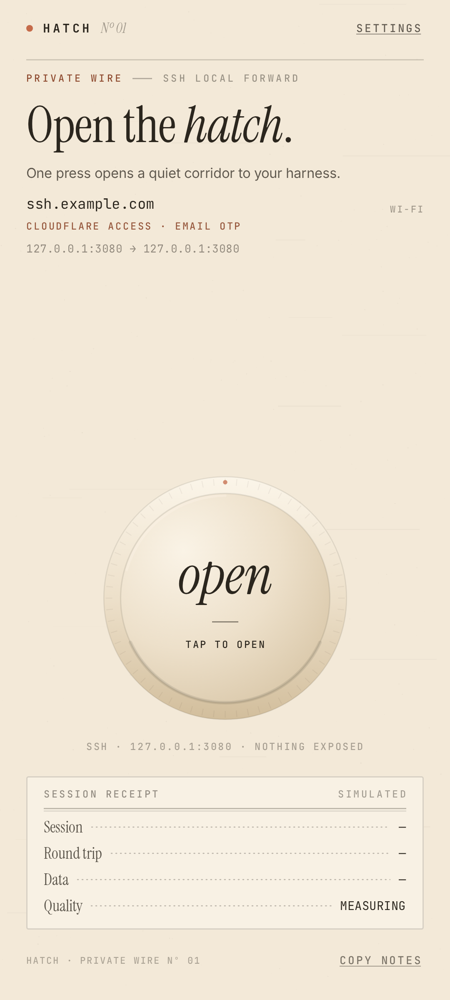
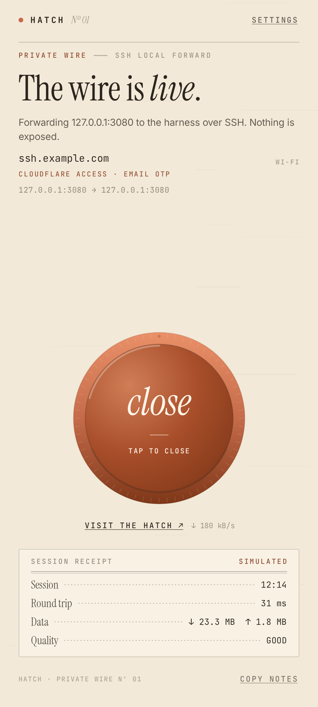
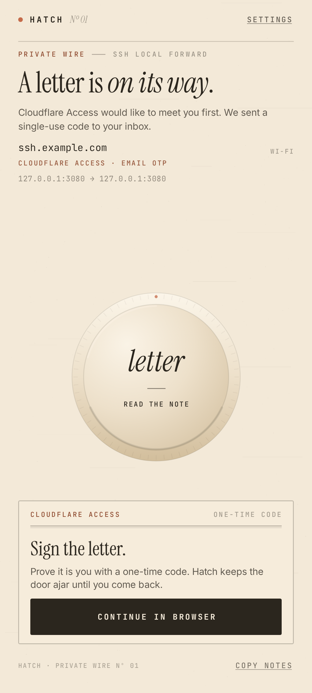

# Hatch

Hatch is a one-screen Android client for a persistent SSH local forward. Configure an SSH
endpoint once, tap the dial, and open a service on the remote machine at
`http://127.0.0.1:3080` from the phone's browser.

It was built to reach a self-hosted developer harness from a phone, but the forward is generic.
The endpoint can be a direct SSH server or an SSH service published through Cloudflare Access
(email one-time code). A Tailscale-only host is also supported, with a preflight warning when the
phone looks disconnected from Tailscale.

**Status: 0.3.0 alpha.** The security baseline is implemented and tested. Background/OEM
reliability and store distribution are not finished. This is a personal-scale project, not a
managed VPN product.

Hatch is not affiliated with Cloudflare, Tailscale, or any harness vendor.

The three-direction UI exploration that led to Tactile is documented in
[`docs/design-history.md`](docs/design-history.md).

<p align="center">
  
  
  
</p>

## What it does

- Opens a local listener on `127.0.0.1:3080` and forwards it over SSH to
  `127.0.0.1:3080` on the remote host.
- Uses private-key or password authentication.
- Carries SSH over a WebSocket when the endpoint is protected by Cloudflare Access, using the
  same transport contract as `cloudflared access ssh`.
- Retries with exponential backoff and jitter, distinguishes DNS/timeout/auth/token failures,
  waits for connectivity instead of burning attempts, and adapts keepalive/probe cadence on a
  poor link.
- Keeps a live tunnel in a foreground service with an ongoing notification.
- Pins the SSH host key on first use and refuses to continue when it changes.
- Encrypts SSH keys, passwords, Access JWTs, and an optional harness token URL with an Android
  Keystore AES-GCM key.
- Warns before connecting to a Tailscale-only host when Tailscale is missing, the VPN is off, or
  MagicDNS does not resolve.

## Requirements

- Android 8.0 (API 26) or newer.
- An SSH server. For the default forward, a service listening on `127.0.0.1:3080` on that server.
- For Cloudflare Access: the hostname must be proxied by Cloudflare, published as an Access
  application, and reachable with the WebSocket SSH transport used by `cloudflared access ssh`.
- Optional: the Tailscale Android app, if the SSH host is a tailnet name.

## Install

There is no store release yet. Build the debug APK:

```bash
git clone <repository-url>
cd hatch
./gradlew :app:assembleDebug
adb install -r app/build/outputs/apk/debug/app-debug.apk
```

For a signed, minified release build, see [`docs/release.md`](docs/release.md). Keep the signing
key private; never commit it or attach it to a release. If you distribute an APK, include the
license and notice files described in [`THIRD_PARTY_NOTICES.md`](THIRD_PARTY_NOTICES.md).

## Configure

Open **Settings** on first launch:

1. **SSH host** and **SSH user** — for example `ssh.example.com` and `you`.
2. **Cloudflare Access** — leave on when the SSH endpoint is published through Access; turn it
   off for a direct TCP connection to port 22.
3. **SSH authentication** — paste a private key and optional passphrase, or choose password auth.
4. **Local forward** — defaults are `127.0.0.1:3080` → `127.0.0.1:3080`. Change the local or
   remote port if your service uses a different one.
5. Optionally set **Harness token URL** if the forwarded service needs an authenticated launch
   URL.

Tap the dial. If the endpoint is protected by Access, a browser window opens for the email
one-time code; Hatch captures the `CF_Authorization` cookie and hands the JWT to the SSH engine.
When the tunnel is live, open `http://127.0.0.1:3080` in any browser on the phone.

The first connection to a host shows its SHA-256 host-key fingerprint. Compare it with the server
before approving; later key changes are fatal until you explicitly forget the pin in
**Settings → SSH HOST KEY**.

### Cloudflare Access notes

- Hatch discovers the Access login URL with `GET https://<host>/`, then upgrades
  `wss://<host>/` with `Cf-Access-Token: <JWT>`. It does not ship a `cloudflared` binary.
- The Access policy must admit the email address you sign in with. The in-app browser is
  HTTPS-only, cancels TLS errors, has no JavaScript bridge, and clears cookies/storage after it
  captures the session.
- The JWT is cached per host, encrypted, and re-validated for expiry. A rejected token sends you
  back through the sign-in flow without consuming a retry.
- See the [Cloudflare Zero Trust documentation](https://developers.cloudflare.com/cloudflare-one/)
  for Access application setup.

### Tailscale notes

If the host ends in `.ts.net` or is in `100.64.0.0/10`, Hatch checks whether the Tailscale app is
installed, whether a VPN transport is active, and whether MagicDNS or the hostname resolves. It
shows **Open Tailscale**, **Connect anyway**, and **Cancel** when something looks wrong. This is
best-effort: Android exposes no Tailscale API, and a tailnet using a custom split-DNS suffix may
not be recognized from the hostname alone.

## Security model

- Credentials and tokens are encrypted at rest with a non-exportable Android Keystore key; the
  0.2 plaintext layout is migrated and removed.
- SSH host keys are trust-on-first-use pinned. A mismatch is fatal and never auto-retried.
- The auth WebView is HTTPS-only and `FLAG_SECURE` covers Settings and sign-in so secrets cannot
  be captured by screenshots or the recents thumbnail.
- Diagnostics copied off-device redact JWTs, token URLs, cookies, private keys, and passwords.
- `allowBackup=false`; there is no analytics, crash reporting, or telemetry.
- The local listener is reachable by any app on the phone. The forwarded service's own token or
  authentication is the gate; this app does not add one.
- There is no biometric gate on the saved SSH key. An unlocked phone can connect.

The full assumptions and residual risks are in [`docs/threat-model.md`](docs/threat-model.md), and
the data-handling summary is in [`docs/privacy.md`](docs/privacy.md).

## Build and test

Toolchain: JDK 21, Android SDK 37, Gradle wrapper 9.3.1, AGP 9.1.0, minSdk 26, targetSdk 37.

```bash
./gradlew :app:testDebugUnitTest :engine:testDebugUnitTest
./gradlew :app:lintDebug
./gradlew :app:assembleDebug
```

Host-side Compose renders (no device or emulator):

```bash
./gradlew :app:updateDebugScreenshotTest
```

That writes reference PNGs under `app/src/screenshotTestDebug/reference/` and is what produced the
screenshots above. The device helper `scripts/shoot.sh` can capture a running debug build with
its debug-only state extras.

Release signing and versioning: [`docs/release.md`](docs/release.md).

## Project layout

```
app/      Compose UI (Tactile), settings, auth WebView, foreground service, controller
engine/   SSH-over-WebSocket transport, Access token handling, host-key pinning, retry/telemetry
docs/     threat model, release process, design history, privacy, screenshots
```

`engine/` is UI-free so the transport and its pure logic can be unit-tested without Android.
`TunnelEngine` is the seam between the real transport and the demo engine used by previews.

## Known limitations

- No reboot auto-start and no guarantee against aggressive OEM battery managers.
- No biometric/PIN gate for the saved SSH key.
- No certificate pinning for Cloudflare (rotation would break it).
- No multi-endpoint profiles; one host configuration per install.
- `specialUse` foreground service and battery-optimization exemption are appropriate for a
  sideloaded build; Google Play distribution would require declarations and a privacy review.
- The Tailscale check is a heuristic, not proof of tailnet membership.
- The UI is English-only and designed around a 411×914 dp phone; larger screens and
  accessibility work are incomplete.

## Contributing

Bug reports and pull requests are welcome. Read [`CONTRIBUTING.md`](CONTRIBUTING.md) and
[`SECURITY.md`](SECURITY.md) first. Never include real hostnames, tokens, keys, or screenshots of
your own deployment in an issue.

## License

Apache License 2.0. See [`LICENSE`](LICENSE) and [`NOTICE`](NOTICE). Bundled font and JSch
licenses are listed in [`THIRD_PARTY_NOTICES.md`](THIRD_PARTY_NOTICES.md).
